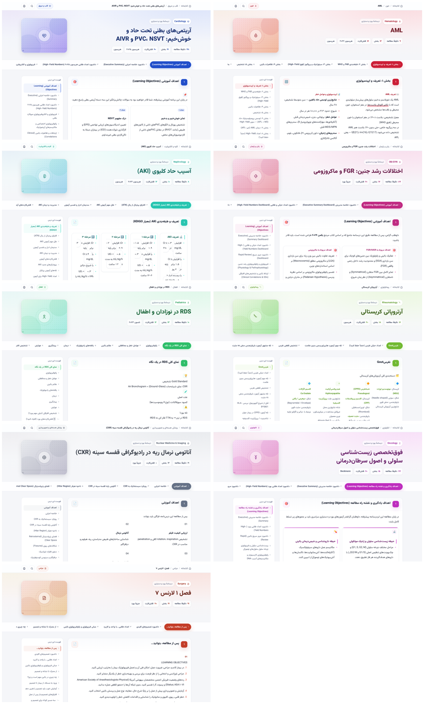
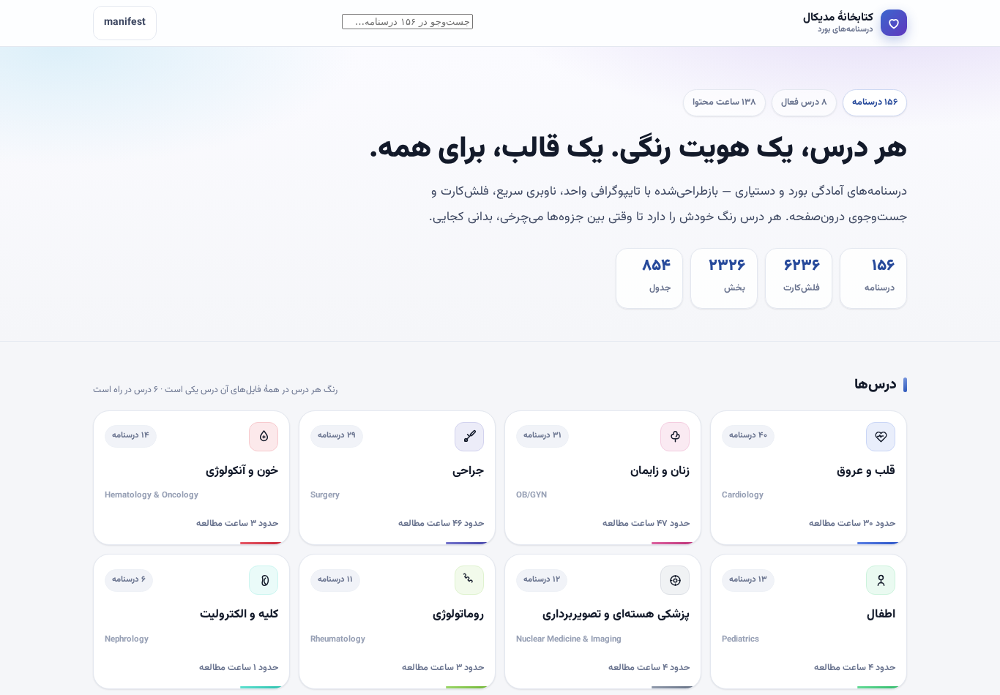

# کتابخانهٔ مدیکال — مخزن درسنامه‌ها

درسنامه‌های فارسی (RTL) آمادگی بورد و دستیاری، بازطراحی‌شده با **یک قالب واحد** و
**یک هویت رنگی برای هر درس**. محتوا دست‌نخورده است؛ فقط قالب، تایپوگرافی و ناوبری نو شده‌اند.

## پیش‌نمایش





## وضعیت فعلی

| مورد | مقدار |
|---|---|
| درسنامه‌ها | ۲۴۶ فایل (۱۵۶ بازطراحی‌شده + ۲۳ فصل چشم‌پزشکی، ۲۰ فصل ارتوپدی و ۴۷ فصل عفونی پیش‌ساخته) |
| درس فعال | ۱۱ درس (+ ۵ درس «به‌زودی») |
| حجم متن | ~۲٬۱۶۴٬۰۰۰ واژه ≈ ۱۸٬۵۴۳ دقیقه (۳۰۹ ساعت) مطالعه |
| حفظ محتوا | ۱۰۰٪ (میانگین نسبت واژه‌های خروجی به ورودی: ۱٫۰۰۷ — فقط افزودنی) |
| بانک سؤال | ۱٬۳۹۰ سؤال در ۱۱ بخش (+ ۱۱ نسخهٔ تک‌فایلی آفلاین) |
| وابستگی خارجی در زمان اجرا | صفر (فونت و آیکون و CSS همه محلی) |

پوشش فعلی درس‌ها (زمان مطالعه):

| درس | تعداد | ساعت | درس | تعداد | ساعت |
|---|---|---|---|---|---|
| قلب و عروق | ۴۰ | ۳۰ | زنان و زایمان | ۳۱ | ۴۷ |
| جراحی (لارنس ۱–۲۸) | ۲۹ | ۴۶ | خون و آنکولوژی | ۱۴ | ۳ |
| اطفال | ۱۳ | ۴ | تصویربرداری/هسته‌ای | ۱۲ | ۴ |
| روماتولوژی | ۱۱ | ۳ | کلیه | ۶ | ۱ |
| چشم‌پزشکی (جوادی) | ۲۳ | ۱۶ | ارتوپدی (اعلمی هرندی) | ۲۰ | ۳۱ |
| عفونی (هریسون ۲۰۲۵) | ۴۷ | ۱۲۴ | **جمع ۱۱ درس فعال** | **۲۴۶** | **۳۰۹** |

**به‌زودی:** تنفس · گوارش و کبد · غدد · مغز و اعصاب · روان‌پزشکی
(رنگ و صفحهٔ هرکدام از قبل تعریف شده؛ فقط فایل درسنامه لازم است)

جمع محتوای فعلی: ۶٬۴۴۸ فلش‌کارت · ۱٬۵۱۳ جدول · ۴٬۱۷۰ سؤال چندگزینه‌ای.

### بانک سؤال (تازه)

۸ فایل آزمونی که جدا از درسنامه‌ها فرستاده شد، حالا یک بخش مستقل و هم‌شکل کتابخانه است؛
بعداً بانک چشم‌پزشکی (`chashm.html` ← بخش `eye`)، بانک ارتوپدی (`ortho.html` ← بخش `ortho`)
و بانک عفونی (`ofuni.html` ← بخش `inf`) هم به آن اضافه شدند:
آزمون تعاملی با بازخورد فوری، فیلتر فصل و سطح دشواری، ذخیرهٔ خودکار پیشرفت و
**نسخهٔ تک‌فایلی آفلاین** برای هر بخش (همه‌چیز — CSS، JS، فونت، داده — درون یک فایل).

| بخش | درس | سؤال | فصل |
|---|---|---|---|
| زنان و زایمان — بکمن | زنان | ۲۰۰ | ۳۸ |
| قلب و عروق — هریسون | قلب | ۲۰۰ | ۵۲ |
| رادیولوژی ۱ / ۲ / ۳ | تصویربرداری | ۶۰ + ۶۰ + ۶۰ | ۱۰ + ۱۰ + ۹ |
| جراحی (لارنس ۱ / ۲ / ۳) | جراحی | ۷۰ + ۷۰ + ۷۰ | ۱۰ + ۱۰ + ۱۰ |
| چشم‌پزشکی عمومی — جوادی | چشم | ۲۰۰ | ۲۳ (فصول ۱–۲۹ به‌جز ۱۰، ۱۹، ۲۰، ۲۳، ۲۴، ۲۵) |
| ارتوپدی و شکستگی‌ها — اعلمی هرندی | ارتوپدی | ۲۰۰ | ۲۰ (فصول ۱، ۳–۱۵، ۱۷، ۱۸، ۲۰–۲۳) |
| بیماری‌های عفونی — هاریسون ۲۰۲۵ | عفونی | ۲۰۰ | ۴۴ (فصل‌های ۱۲۴–۳۱۵ بخش ۵ هریسون، ویراست ۲۲) |

بخش ارتوپدی **۴۲ سؤال تصویردار** دارد (تصاویر Wikimedia Commons با ذکر پدیدآور و مجوز،
به‌صورت `data:image/jpeg;base64` درون‌خطی — یعنی آفلاین هم کار می‌کنند). به همین دلیل موتور
آزمون (`assets/theme/qbank.js`) تصویر سؤال را زیر صورت سؤال رندر می‌کند: `figure` با
`alt`، زیرنویس و اعتبارنامهٔ تصویر، پیوند «منبع تصویر»، و بزرگ‌نمایی تمام‌صفحه با کلیک
یا Enter (بستن با کلیک یا `Esc`). بخش‌هایی که تصویر ندارند هیچ تغییری نمی‌کنند.

> **دو بانک متفاوت برای درس عفونی.** درسنامه‌های عفونی هرکدام ۱۵ MCQ درون‌درسی دارند که
> همهٔ ۷۰۵ تایشان در یک صفحهٔ جدا جمع شده‌اند: `content/subject/infectious-exam.html`
> (فیلتر فصل، جست‌وجو، ترتیب تصادفی، پیشرفت با کلید `medx.infectious.exam.v1`).
> بخش `inf` در `content/qbank/` بانک تألیفی ۲۰۰ سؤالیِ هاریسون ۲۰۲۵ است (از `ofuni.html`).
> صفحهٔ درس عفونی **هر دو** را نشان می‌دهد؛ این دو جای هم را نمی‌گیرند.

این‌ها با بخش `qbank` خودِ اپ planner **یکی نیستند و با آن تعارض ندارند**: آن‌جا سؤال‌های
واقعی آزمون‌های سال‌های گذشته بر اساس سال و مبحث است؛ این‌جا بانک فصل‌به‌فصل کتاب‌محور
با پاسخ تشریحی، تحلیل گزینه‌های نادرست، نکتهٔ کلیدی و تلهٔ آزمون. مکمل هم‌اند.

## ساختار

```
med-library/
├─ assets/
│  ├─ fonts/            Vazirmatn (Regular → Black) — محلی، بدون CDN
│  └─ theme/
│     ├─ base.css       سیستم طراحی: توکن‌ها + کامپوننت‌های درسنامه
│     ├─ library.css    ظاهر صفحهٔ خانه و صفحهٔ درس‌ها
│     ├─ qbank.css      ظاهر بانک سؤال (کارت سؤال، بازخورد، خلاصه، تصویر و لایهٔ بزرگ‌نمایی)
│     ├─ qbank.js       موتور آزمون: فیلتر، ذخیرهٔ پیشرفت، میان‌بر کلید، رندر تصویر سؤال
│     ├─ viewer.js      ناوبری فعال، نوار پیشرفت، جست‌وجوی درون‌درس (Ctrl+K)
│     └─ library.js     جست‌وجوی زندهٔ فهرست درسنامه‌ها
├─ build/
│  ├─ subjects.json     ← پالت ۱۶ درس (فقط عدد hue/chroma)
│  ├─ subjects.map.json ← نقشهٔ فایل → درس (تولیدشده)
│  ├─ make_map.py       ساخت نقشه از پوشهٔ raw_src
│  ├─ build.py          تبدیل هر فایل قدیمی به قالب جدید
│  ├─ gen_library.py    ساخت index + صفحهٔ هر درس + manifest.json
│  ├─ qb_extract.py     استخراج آرایهٔ سؤال از بانک تک‌فایلی HTML → qbank/raw/
│  ├─ qb_normalize.py   یک‌شکل‌کردن فایل‌های خام بانک سؤال (چهار طرح دادهٔ متفاوت)
│  ├─ qb_build.py       ساخت صفحات آزمون + فهرست + نسخهٔ تک‌فایلی + هم‌خط‌کردن qbank در manifest
│  ├─ medx_build.py     پورتال، داشبورد درس‌ها، درسنامه‌ها و همگام‌سازی docs/lib
│  ├─ icons.py          آیکون‌های SVG هر درس (بدون ایموجی/شبکه)
│  └─ report.json       گزارش کیفیت هر فایل (حفظ محتوا، بخش‌ها، خطاها)
├─ raw_src/             فایل‌های اصلی (ورودی خام، دست‌نخورده)
├─ qbank/
│  ├─ raw/            فایل‌های خام (در مخزن: chashm.json، ortho.json)
│  └─ data/           نسخهٔ نرمال‌شده و یک‌شکل (منبع ساخت) + _parts.json (آمار بخش‌ها)
├─ content/             ★ خروجی قابل انتشار (خودبسنده)
│  ├─ index.html
│  ├─ manifest.json
│  ├─ assets/           کپی CSS + فونت + JS (خودکار)
│  ├─ subject/<key>.html
│  ├─ infectious/
│  │  ├─ *.html        ۴۴ فصل هاریسون ۲۰۲۵ + ۳ مصوبهٔ ۱۴۰۳ سل (پیش‌ساخته)
│  │  └─ manifest.json شناسنامهٔ منبع + examBankPage
│  ├─ ophthalmology/
│  │  ├─ chapter-*.html ۲۳ فصل چشم‌پزشکی (صفحهٔ پیش‌ساخته و خودبسنده)
│  │  └─ manifest.json شناسنامهٔ منبع (جوادی، ویراست ۲، ۱۳۹۷)
│  ├─ orthopedics/
│  │  ├─ chapter-*.html ۲۰ فصل ارتوپدی (صفحهٔ پیش‌ساخته و خودبسنده)
│  │  └─ manifest.json شناسنامهٔ منبع (اعلمی هرندی، ویرایش ۶، ۱۳۹۷)
│  ├─ qbank/            فهرست آزمون‌ها + ۱۱ صفحه + ۱۱ تک‌فایلی + data/
│  └─ <subject>/<slug>.html
└─ integration/lessonLinks.ts   اتصال به اپ planner
```

## دو فایل راهنما

- **`PROMPT-lessons.md`** — پرامپت آماده برای ساخت درسنامه‌های ۶ درس باقی‌مانده + فهرست
  موضوعات پیشنهادی هر درس + معیار پذیرش.
- **`PROMPT-agent-deploy.md`** — پرامپت ایجنت GitHub برای ساخت مخزن، انتشار روی Pages،
  بررسی سلامت و ساخت PR اتصال به اپ.

## افزودن فایل‌های جدید

```bash
# ۱) فایل‌های تازه را در raw_src/ بریز (هر نامی، فارسی یا انگلیسی)
#    (پوشهٔ assets خودکار داخل content/ کپی می‌شود — برای انتشار فقط content/ لازم است)
# ۲) نقشهٔ درس‌ها را دوباره بساز (فایل‌های قبلی حفظ می‌شوند)
python3 build/make_map.py
# ۳) درسنامه‌ها را بساز — خروجی قبلی پاک و از نو ساخته می‌شود
python3 build/build.py
# ۴) خانه + صفحهٔ درس‌ها + manifest
python3 build/gen_library.py
```

اگر درسی درست تشخیص داده نشد، در `build/subjects.map.json` مقدار `subject` آن فایل را
دستی عوض کن (یا الگویش را در `build/make_map.py` اضافه کن) و دوباره بساز.
فایل‌هایی که با اطمینان پایین تشخیص داده شوند با `needsReview: true` علامت می‌خورند.

## افزودن بانک سؤال جدید

هر فایل آزمونی که می‌فرستی، این مسیر را طی می‌کند:

```bash
# ۱) اگر بانک به‌صورت HTML تک‌فایلی است (chashm.html، ortho.html)، فقط آرایهٔ سؤال‌ها
#    را استخراج کن؛ وگرنه فایل خام JSON را در qbank/raw/ بگذار:
python3 build/qb_extract.py ortho.html              # → qbank/raw/ortho.json
python3 build/qb_extract.py ortho.html --check      # بررسی بدون نوشتن
# ۲) در build/qb_normalize.py یک سطر به BUNDLES اضافه کن:
#    ("<درس>", "<نام‌بخش>", "<عنوان فارسی>", ["<نام فایل>.json"])
# ۳) در build/medx/data.py یک سطر به QBANK_PARTS اضافه کن (برای پورتال و داشبورد درس)
python3 build/qb_normalize.py              # نرمال‌سازی + آمار بخش‌ها (qbank/data/_parts.json)
python3 build/qb_build.py                  # صفحات آزمون + تک‌فایلی‌ها + qbank در manifest.json
python3 build/medx_build.py --portal-only  # پورتال + داشبورد درس‌ها + همگام‌سازی docs/lib
```

> `build/gen_library.py` پوستهٔ **قدیمی** کتابخانه را می‌سازد و `manifest.json` را از
> `build/report.json` (بدون درس‌های پیش‌ساخته) بازنویسی می‌کند؛ برای انتشار فعلی اجرایش نکن.
>
> وابستگی‌ها: فقط `build/medx_build.py` به `lxml` نیاز دارد (`pip install lxml`)؛ بقیهٔ خط لوله
> با پایتونِ بدون کتابخانهٔ اضافی اجرا می‌شود. `--portal-only` پورتال و داشبورد درس‌ها را از
> `content/manifest.json` + `build/medx-report.json` می‌سازد و به ۲۴۶ درسنامه دست نمی‌زند.

نرمال‌ساز خودش چهار طرح دادهٔ مختلف را می‌شناسد و همه را به یک شکل درمی‌آورد:

| در فایل خام | تبدیل به |
|---|---|
| `chapter` / `ch` | `chapter` |
| `chapterTitle` / `chTitle` | `chapterTitle` |
| `difficulty` / `diff` (انگلیسی) | `difficulty` («آسان» … «خیلی دشوار») |
| `whyWrong{idx: متن}` | `whyWrong{idx: متن}` |
| `whyWrong["", …]` (آرایهٔ ۴تایی) | `whyWrong{idx: متن}` — جای گزینهٔ درست حذف می‌شود |
| `wrongExps[3]` (بدون ایندکس) | `whyWrong{idx: متن}` — به ترتیب روی گزینه‌های غلط می‌نشیند |
| `A) …` در ابتدای گزینه | حذف می‌شود (حرف با CSS نشان داده می‌شود) |
| `answer` / `correctExplanation` | `correct` / `explanation` (بانک‌های تک‌فایلی: چشم و ارتوپدی) |
| `optionRationales[4]` | `whyWrong{idx: متن}` (جای گزینهٔ درست حذف می‌شود) |
| `clinicalPearl` / `examTrap` / `highYield` | `pearl` / `trap` / `highYield` |
| `image{src, alt, credit, source, w, h}` | `image` (همان‌ها؛ فقط اگر سؤال تصویر داشته باشد) |
| `questionType(Label)`، `coverageIndex`، `difficultyFa`، `referenceBook/edition/Pages/Section` | به‌عنوان متا حفظ می‌شوند |

## پالت درس‌ها (۱۶ کلید)

هر درس یک `hue` دارد و کل رنگ‌های صفحه (سطح‌ها، بوردرها، گرادیان، آیکون، نوار پیشرفت)
از همان ساخته می‌شود — پس هیچ‌وقت دو درس دقیقاً هم‌رنگ نمی‌شوند و معنای رنگ‌های
هشدار/نکته/طلایی در همهٔ درس‌ها ثابت می‌ماند.

| کلید | درس | hue | رنگ | کلید اتصال به اپ |
|---|---|---|---|---|
| `cardio` | قلب و عروق | ۲۲۴ | سورمه‌ای | `cardiology-nematpour`, `internal-cecil` |
| `pulmo` | تنفس | ۱۹۷ | آبی آسمانی | `pulmonology-harrison` |
| `nephro` | کلیه و الکترولیت | ۱۷۲ | فیروزه‌ای | `nephrology-harrison` |
| `gi` | گوارش و کبد | ۳۸ | کهربایی | `gastroenterology-harrison` |
| `endo` | غدد | ۲۷۰ | بنفش | `endocrinology-harrison` |
| `heme` | **خون و آنکولوژی** | ۳۵۴ | قرمز یاقوتی | `hematology-harrison`, `pathology-robbins` |
| `rheum` | روماتولوژی | ۹۲ | زیتونی | `rheumatology-harrison` |
| `surgery` | جراحی | ۲۴۰ | آبی ناوی | `surgery-lawrence`, `urology-simforoush`, `ent-goldenberg` |
| `ophthalmology` | چشم‌پزشکی | ۱۸۷ | فیروزه‌ای | `ophthalmology-javadi` |
| `orthopedics` | ارتوپدی | ۱۶ | آجری | `orthopedics-alamiharandi` |
| `infectious` | عفونی | ۱۶۸ | فیروزه‌ای زمردی | `infectious-harrison` |
| `obgyn` | زنان و زایمان | ۳۳۰ | سرخابی | `gynecology-beckmann` |
| `peds` | اطفال | ۱۴۵ | سبز | `pediatrics-nelson` |
| `imaging` | پزشکی هسته‌ای و تصویربرداری | ۲۱۸ | فولادی | `radiology-herring`, `medical-physics` |
| `neuro` | مغز و اعصاب | ۲۹۲ | ارجوانی-نیلی | `neurology-aminoff` |
| `psych` | روان‌پزشکی | ۳۱۲ | بنفش صورتی | `psychiatry-dahrfar` |

تغییر رنگ یک درس = تغییر یک عدد در `build/subjects.json` و اجرای دوبارهٔ ساخت.
`onco` حذف شد و درسنامه‌های انکولوژی زیر «خون و آنکولوژی» می‌روند؛ درس‌های بدون فایل
به‌صورت کارت «به‌زودی» در صفحهٔ خانه نمایش داده می‌شوند.

## قالب جدید چه دارد؟

- **هدر چسبان** با مسیر (خانه › درس › درسنامه)، نوار پیشرفت مطالعهٔ واقعی.
- **هیرو** با کاور SVG اختصاصی هر درس (بدون تصویر خارجی) و متادیتای خواندن.
- **ناوبری بخش‌ها** به‌صورت چیپ‌های افقی چسبان + فهرست کامل در ستون کنار (دسکتاپ).
- **سایدبار** با فهرست فعال، حلقهٔ پیشرفت و جست‌وجوی درون‌درس (`Ctrl/⌘ + K`).
- **بخش‌بندی خودکار** محتوای قدیمی به کارت‌های شماره‌دار با آیکون معنایی.
- **جدول‌های اسکرول‌پذیر** با هدر چسبان و ردیف‌های راه‌راه.
- **فلش‌کارت و MCQ** با استایل تازه؛ دکمهٔ چاپ/PDF همهٔ جزئیات را باز می‌کند.
- **شبکهٔ خانه** با جست‌وجوی زنده (نرمال‌سازی ی/ک/همزه) و صفحهٔ مستقل هر درس.
- **بدون شبکه**: فونت‌ها و آیکون‌ها محلی‌اند؛ برای PWA و مطالعهٔ آفلاین آماده است.

## اتصال به اپ planner

`content/manifest.json` همان قرارداد manifest (نسخه، `basePath`، فهرست درس‌ها) است و در کنارش
`appSubjectKeys` دارد. فایل آمادهٔ `integration/lessonLinks.ts` را در
`src/lib/lessonLinks.ts` ریپوی برنامه‌ریز بگذار و در کارت مبحث، دکمهٔ «درسنامه» را
نمایش بده — جزئیات و نمونهٔ کد داخل همان فایل است.

**بانک سؤال کتابخانه را با بانک سؤال اپ یکی نکن.** دو سیستم جدا هستند و عمداً جدا ماندند:

| | بانک سؤال اپ (`docs/qbank/`) | بانک سؤال کتابخانه (`content/qbank/`) |
|---|---|---|
| واحد سازمان | سال آزمون + مبحث (`topicId`) | فصل کتاب + درس |
| محتوا | سؤال‌های واقعی آزمون‌های گذشته | سؤال کتاب‌محور با پاسخ تشریحی |
| داده | شاردهای `.json.gz` + `manifest` | یک JSON برای هر بخش (۷۰–۲۰۰ سؤال) |
| هدف | آزمون شبیه‌سازی‌شده با تایمر | مرور فصل‌به‌فصل بعد از خواندن درسنامه |

اگر خواستی از داخل اپ به آزمون‌های کتابخانه لینک بدهی، فقط یک لینک بیرونی بده
(`https://mmr363637-afk.github.io/med-library/lib/qbank/<part>.html`) — همان کاری که
`lessonLinks.ts` برای درسنامه‌ها می‌کند. این دو را ادغام نکن؛ قرارداد داده‌شان یکی نیست.

## کیفیت و بازبینی

`build/report.json` برای هر فایل این‌ها را دارد: تعداد بخش، واژه، دقیقه، فلش‌کارت،
جدول، MCQ، نسبت حفظ محتوا (`preserved`) و شمارندهٔ اصلاح‌ها. اگر `preserved` زیر
۰٫۹۷ بیاید، در خروجی ساخت هشدار چاپ می‌شود.

## نکتهٔ حقوقی

متن‌ها بر پایهٔ منابعی مثل هریسون، نلسون و بکمن نوشته شده‌اند و برگرفته از یادداشت‌های
شخصی‌اند؛ پیش از انتشار عمومی، بازبینی محتوایی و حقوقی لازم است.
