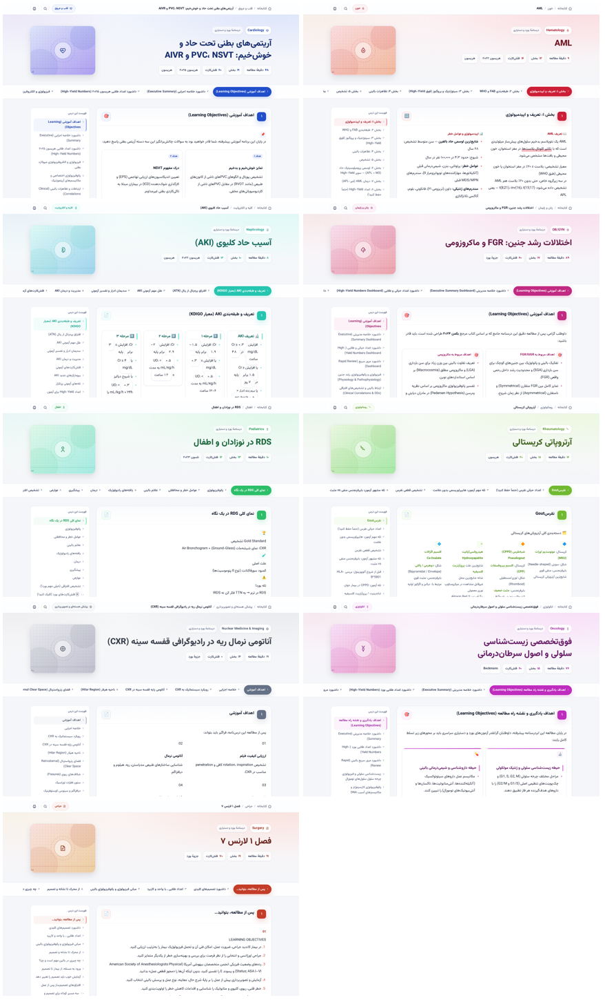
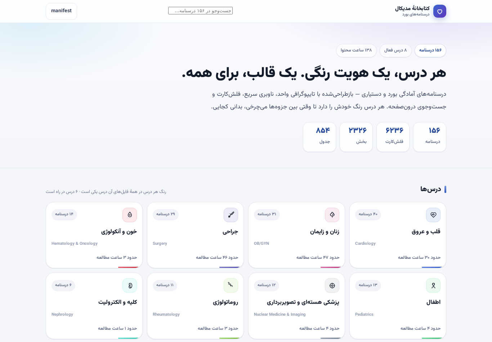

# کتابخانهٔ مدیکال — مخزن درسنامه‌ها

درسنامه‌های فارسی (RTL) آمادگی بورد و دستیاری، بازطراحی‌شده با **یک قالب واحد** و
**یک هویت رنگی برای هر درس**. محتوا دست‌نخورده است؛ فقط قالب، تایپوگرافی و ناوبری نو شده‌اند.

## پیش‌نمایش





## وضعیت فعلی

| مورد | مقدار |
|---|---|
| درسنامه‌ها | ۳۲۰ فایل (۱۵۶ بازطراحی‌شده + ۲۳ چشم‌پزشکی، ۲۰ ارتوپدی، ۴۷ عفونی، ۲۸ اورولوژی، ۳۲ ENT و ۱۴ مغز و اعصاب پیش‌ساخته) |
| درس فعال | ۱۴ درس (+ ۴ درس «به‌زودی») |
| حجم متن | ~۲٬۴۹۷٬۰۰۰ واژه ≈ ۲۲٬۴۵۱ دقیقه (۳۷۴ ساعت) مطالعه |
| حفظ محتوا | ۱۰۰٪ (میانگین نسبت واژه‌های خروجی به ورودی: ۱٫۰۰۷ — فقط افزودنی) |
| بانک سؤال | ۱٬۹۹۰ سؤال در ۱۴ بخش (+ ۱۴ نسخهٔ تک‌فایلی آفلاین) |
| بخش آزمایشگاه | ۲ ابزار: شبیه‌ساز قلب (۱۸ سناریو) و PulmoLab Studio (۸ ایستگاه، ۷۰ رادیوگرافی) |
| وابستگی خارجی در زمان اجرا | صفر (فونت و آیکون و CSS همه محلی) |

پوشش فعلی درس‌ها (زمان مطالعه):

| درس | تعداد | ساعت | درس | تعداد | ساعت |
|---|---|---|---|---|---|
| قلب و عروق | ۴۰ | ۳۰ | زنان و زایمان | ۳۱ | ۴۷ |
| جراحی (لارنس ۱–۲۸) | ۲۹ | ۴۶ | خون و آنکولوژی | ۱۴ | ۳ |
| اطفال | ۱۳ | ۴ | تصویربرداری/هسته‌ای | ۱۲ | ۴ |
| روماتولوژی | ۱۱ | ۳ | کلیه | ۶ | ۱ |
| چشم‌پزشکی (جوادی) | ۲۳ | ۱۶ | ارتوپدی (اعلمی هرندی) | ۲۰ | ۳۱ |
| عفونی (هریسون ۲۰۲۵) | ۴۷ | ۱۲۴ | اورولوژی (سیم‌فروش ۱۴۰۲) | ۲۸ | ۴۰ |
| گوش، حلق و بینی (هندبوک ۲۰۱۸) | ۳۲ | ۹ | مغز و اعصاب (نورولوژی بالینی ۲۰۲۱) | ۱۴ | ۱۶ |
| **جمع ۱۴ درس فعال** | **۳۲۰** | **۳۷۴** | | | |

**به‌زودی:** تنفس (ابزارش آماده است: آزمایشگاه ریهٔ PulmoLab در بخش آزمایشگاه) ·
گوارش و کبد · غدد · روان‌پزشکی
(رنگ و صفحهٔ هرکدام از قبل تعریف شده؛ فقط فایل درسنامه لازم است)

جمع محتوای فعلی: ۷٬۷۳۷ فلش‌کارت · ۱٬۹۷۱ جدول · ۵٬۲۸۰ سؤال چندگزینه‌ای.

### بانک سؤال (تازه)

۸ فایل آزمونی که جدا از درسنامه‌ها فرستاده شد، حالا یک بخش مستقل و هم‌شکل کتابخانه است؛
بعداً بانک چشم‌پزشکی (`chashm.html` ← بخش `eye`)، بانک ارتوپدی (`ortho.html` ← بخش `ortho`)،
بانک عفونی (`ofuni.html` ← بخش `inf`)، بانک اورولوژی (`urology.html` ← بخش `uro`)،
بانک ENT (`ENT.html` ← بخش `ent`) و بانک نورولوژی (`neurology.html` ← بخش `neuro`)
هم به آن اضافه شدند:
آزمون تعاملی با بازخورد فوری، فیلتر فصل و سطح دشواری، ذخیرهٔ خودکار پیشرفت و
**نسخهٔ تک‌فایلی آفلاین** برای هر بخش (همه‌چیز — CSS، JS، فونت، داده — درون یک فایل).

| بخش | درس | سؤال | فصل |
|---|---|---|---|
| زنان و زایمان — بکمن | زنان | ۲۰۰ | ۳۸ |
| قلب و عروق — هریسون | قلب | ۲۰۰ | ۵۲ |
| رادیولوژی ۱ / ۲ / ۳ | تصویربرداری | ۶۰ + ۶۰ + ۶۰ | ۱۰ + ۱۰ + ۹ |
| جراحی (لارنس ۱ / ۲ / ۳) | جراحی | ۷۰ + ۷۰ + ۷۰ | ۱۰ + ۱۰ + ۱۰ |
| چشم‌پزشکی عمومی — جوادی | چشم | ۲۰۰ | ۲۳ (فصول ۱–۲۹ به‌جز ۱۰، ۱۹، ۲۰، ۲۳، ۲۴، ۲۵) |
| ارتوپدی و شکستگی‌ها — اعلمی هرندی | ارتوپدی | ۲۰۰ | ۲۰ (فصول ۱، ۳–۱۵، ۱۷، ۱۸، ۲۰–۲۳) |
| بیماری‌های عفونی — هاریسون ۲۰۲۵ | عفونی | ۲۰۰ | ۴۴ (فصل‌های ۱۲۴–۳۱۵ بخش ۵ هریسون، ویراست ۲۲) |
| اورولوژی — سیم‌فروش ۱۴۰۲ | اورولوژی | ۲۰۰ | ۲۸ |
| گوش، حلق و بینی — هندبوک اتولارینگولوژی | ENT | ۲۰۰ | ۹ (بخش‌های اصلی کتاب؛ ۱۱۶ زیربخش در `topic`) |
| مغز و اعصاب — نورولوژی بالینی ۲۰۲۱ | مغز و اعصاب | ۲۰۰ | ۱۴ (۱۳ فصل + پیوست معاینهٔ اعصاب محیطی) |

بخش ارتوپدی **۴۲ سؤال تصویردار** دارد (تصاویر Wikimedia Commons با ذکر پدیدآور و مجوز،
به‌صورت `data:image/jpeg;base64` درون‌خطی — یعنی آفلاین هم کار می‌کنند). به همین دلیل موتور
آزمون (`assets/theme/qbank.js`) تصویر سؤال را زیر صورت سؤال رندر می‌کند: `figure` با
`alt`، زیرنویس و اعتبارنامهٔ تصویر، پیوند «منبع تصویر»، و بزرگ‌نمایی تمام‌صفحه با کلیک
یا Enter (بستن با کلیک یا `Esc`). بخش‌هایی که تصویر ندارند هیچ تغییری نمی‌کنند.

> **دو بانک متفاوت برای درس عفونی.** درسنامه‌های عفونی هرکدام ۱۵ MCQ درون‌درسی دارند که
> همهٔ ۷۰۵ تایشان در یک صفحهٔ جدا جمع شده‌اند: `content/subject/infectious-exam.html`
> (فیلتر فصل، جست‌وجو، ترتیب تصادفی، پیشرفت با کلید `medx.infectious.exam.v1`).
> بخش `inf` در `content/qbank/` بانک تألیفی ۲۰۰ سؤالیِ هاریسون ۲۰۲۵ است (از `ofuni.html`).
> صفحهٔ درس عفونی **هر دو** را نشان می‌دهد؛ این دو جای هم را نمی‌گیرند.

این‌ها با بخش `qbank` خودِ اپ planner **یکی نیستند و با آن تعارض ندارند**: آن‌جا سؤال‌های
واقعی آزمون‌های سال‌های گذشته بر اساس سال و مبحث است؛ این‌جا بانک فصل‌به‌فصل کتاب‌محور
با پاسخ تشریحی، تحلیل گزینه‌های نادرست، نکتهٔ کلیدی و تلهٔ آزمون. مکمل هم‌اند.

## بخش آزمایشگاه تعاملی

ابزارهای شبیه‌سازی بالینی، جدا از درسنامه‌ها و اسکچ‌نوت‌ها، در `content/labs/` زندگی می‌کنند
و `build/build_labs.py` مسئول همهٔ آن‌هاست (ساخت فهرست، کپی دست‌نخوردهٔ ابزارها،
`labs-manifest.json`، نوار «آزمایشگاه تعاملی» در صفحهٔ خانه و آینهٔ `docs/lib/labs`).

| ابزار | شکل | ورودی | چه دارد |
|---|---|---|---|
| شبیه‌ساز بالینی قلب | `wrapper` (تک‌فایلی) | `cardiac-simulator (4).html` در ریشه | ۱۸ سناریو در ۳ خانواده، مدل سه‌بعدی قلب، ECG ۱۲ لید، همودینامیک و صدا؛ صفحهٔ معرفی با قاب ایزوله (`labs/cardiac/index.html`) و کپی دست‌نخوردهٔ شبیه‌ساز (`simulator.html`) |
| آزمایشگاه ریهٔ PulmoLab | `pwa` (چندفایلی) | `PulmoLab-Studio-Offline.zip` در ریشه | ۸ ایستگاه: سمع با طیف‌نگار، اطلس PACS با ۷۰ رادیوگرافی، اسپیرومتری/PFT، ۳۰ بیماری، معاینهٔ قفسهٔ سینه، ۸ کیس ICU/ER، جست‌وجو و مدیریت آفلاین؛ `manifest.webmanifest` و `sw.js` خودش را دارد |

بستهٔ PulmoLab بایت‌به‌بایت از زیپ بیرون می‌آید (فقط زیرِ `content/labs/pulmolab/`) و
**هیچ ویرایشی روی آن انجام نمی‌شود**؛ همهٔ ارجاع‌هایش نسبی‌اند، پس زیر هر مسیر پایه
(از جمله `docs/lib/labs/…` در GitHub Pages) کار می‌کند. اعتبارنامهٔ ۷۰ رادیوگرافی و
۱۴ فایل صوتی واقعی در `media/cxr/ATTRIBUTION.json` و `media/audio/ATTRIBUTION.json` است
(Wikimedia Commons: CC0 / CC BY / CC BY-SA با ذکر پدیدآور و نشانی منبع) و
`tests/test-marks.js` گروه `[۱۲]` کامل بودنش را راستی‌آزمایی می‌کند.

```bash
python3 build/build_labs.py --check              # وضعیت بسته‌ها و هم‌خطی نوار صفحهٔ خانه
python3 build/build_labs.py                      # ساخت/به‌روزرسانی + آینهٔ docs/lib
python3 build/build_labs.py --refresh-pulmolab   # بازنویسی بسته از زیپ (اگر دستی دست خورده باشد)
```

## ساختار

```
med-library/
├─ assets/
│  ├─ fonts/            Vazirmatn (Regular → Black) — محلی، بدون CDN
│  └─ theme/
│     ├─ base.css       سیستم طراحی: توکن‌ها + کامپوننت‌های درسنامه
│     ├─ library.css    ظاهر صفحهٔ خانه و صفحهٔ درس‌ها
│     ├─ qbank.css      ظاهر بانک سؤال (کارت سؤال، بازخورد، خلاصه، تصویر و لایهٔ بزرگ‌نمایی)
│     ├─ qbank.js       موتور آزمون: فیلتر، ذخیرهٔ پیشرفت، میان‌بر کلید، رندر تصویر سؤال
│     ├─ marks-lite.js  هایلایت رنگی + پنل نشانه‌ها برای صفحه‌های خودبسنده/بانک‌ها (بدون وابستگی)
│     ├─ marks-lite.css ظاهر همان لایه (نوار رنگ، FAB، پنل، توست)
│     ├─ viewer.js      ناوبری فعال، نوار پیشرفت، جست‌وجوی درون‌درس (Ctrl+K)
│     └─ library.js     جست‌وجوی زندهٔ فهرست درسنامه‌ها
├─ build/
│  ├─ subjects.json     ← پالت ۱۸ درس (فقط عدد hue/chroma + کلیدهای اتصال به اپ)
│  ├─ subjects.map.json ← نقشهٔ فایل → درس (تولیدشده)
│  ├─ make_map.py       ساخت نقشه از پوشهٔ raw_src
│  ├─ build.py          تبدیل هر فایل قدیمی به قالب جدید
│  ├─ gen_library.py    ساخت index + صفحهٔ هر درس + manifest.json
│  ├─ qb_extract.py     استخراج آرایهٔ سؤال از بانک تک‌فایلی HTML → qbank/raw/
│  ├─ qb_normalize.py   یک‌شکل‌کردن فایل‌های خام بانک سؤال (پنج طرح دادهٔ متفاوت)
│  ├─ qb_build.py       ساخت صفحات آزمون + فهرست + نسخهٔ تک‌فایلی + هم‌خط‌کردن qbank در manifest
│  ├─ sync_family.py    آمار خانواده‌های پیش‌ساخته از خود صفحه‌ها → manifest خانواده + manifest ریشه + گزارش (--check)
│  ├─ medx_build.py     پورتال، داشبورد درس‌ها، درسنامه‌ها و همگام‌سازی docs/lib
│  ├─ inject_marks_credit.py  هایلایت + اعتبار نویسنده برای صفحه‌های پیش‌ساخته/بانک‌های ریشه (idempotent)
│  ├─ sync_docs.py      همگام‌سازی تم و آینه‌های انتشار (بدون lxml؛ --check)
│  ├─ build_labs.py     بخش آزمایشگاه: کپی دست‌نخوردهٔ ابزارها، فهرست، نوار صفحهٔ خانه، آینهٔ docs
│  ├─ build_sketch_library.py  بخش اسکچ‌نوت + نوار آن در صفحهٔ خانه (idempotent)
│  ├─ icons.py          آیکون‌های SVG هر درس (بدون ایموجی/شبکه)
│  └─ report.json       گزارش کیفیت هر فایل (حفظ محتوا، بخش‌ها، خطاها)
├─ tests/
│  ├─ audit-library.py  ممیزی خودکار: هایلایت + اعتبار نویسنده در همهٔ فایل‌های HTML کتابخانه
│  └─ test-marks.js     راستی‌آزمایی رفتاری لایه‌های هایلایت در jsdom
├─ raw_src/             فایل‌های اصلی (ورودی خام، دست‌نخورده)
├─ qbank/
│  ├─ raw/            فایل‌های خام (git-ignore؛ با qb_extract.py از بانک تک‌فایلی ساخته
│  │                  می‌شود — فقط chashm.json از پیش در مخزن مانده است)
│  └─ data/           نسخهٔ نرمال‌شده و یک‌شکل (منبع ساخت) + _parts.json (آمار بخش‌ها)
├─ content/             ★ خروجی قابل انتشار (خودبسنده)
│  ├─ index.html
│  ├─ manifest.json
│  ├─ assets/           کپی CSS + فونت + JS (خودکار)
│  ├─ subject/<key>.html
│  ├─ infectious/
│  │  ├─ *.html        ۴۴ فصل هاریسون ۲۰۲۵ + ۳ مصوبهٔ ۱۴۰۳ سل (پیش‌ساخته)
│  │  └─ manifest.json شناسنامهٔ منبع + examBankPage
│  ├─ ophthalmology/
│  │  ├─ chapter-*.html ۲۳ فصل چشم‌پزشکی (صفحهٔ پیش‌ساخته و خودبسنده)
│  │  └─ manifest.json شناسنامهٔ منبع (جوادی، ویراست ۲، ۱۳۹۷)
│  ├─ orthopedics/
│  │  ├─ chapter-*.html ۲۰ فصل ارتوپدی (صفحهٔ پیش‌ساخته و خودبسنده)
│  │  └─ manifest.json شناسنامهٔ منبع (اعلمی هرندی، ویرایش ۶، ۱۳۹۷)
│  ├─ urology/          ۲۸ درسنامهٔ اورولوژی (سیم‌فروش ۱۴۰۲) + manifest.json
│  ├─ ent/              ۳۲ درسنامهٔ ENT (هندبوک اتولارینگولوژی ۲۰۱۸) + manifest.json
│  ├─ neurology/        ۱۴ درسنامهٔ مغز و اعصاب (نورولوژی بالینی ۲۰۲۱) + manifest.json
│  ├─ sketches/         ۶۷ اسکچ‌نوت + فهرست و دو صفحهٔ درس
│  ├─ labs/             فهرست آزمایشگاه‌ها + cardiac/ + pulmolab/ + labs-manifest.json
│  ├─ qbank/            فهرست آزمون‌ها + ۱۴ صفحه + ۱۴ تک‌فایلی + data/
│  └─ <subject>/<slug>.html
└─ integration/lessonLinks.ts   اتصال به اپ planner
```

## دو فایل راهنما

- **`PROMPT-lessons.md`** — پرامپت آماده برای ساخت درسنامه‌های ۶ درس باقی‌مانده + فهرست
  موضوعات پیشنهادی هر درس + معیار پذیرش.
- **`PROMPT-agent-deploy.md`** — پرامپت ایجنت GitHub برای ساخت مخزن، انتشار روی Pages،
  بررسی سلامت و ساخت PR اتصال به اپ.

## افزودن فایل‌های جدید

```bash
# ۱) فایل‌های تازه را در raw_src/ بریز (هر نامی، فارسی یا انگلیسی)
#    (پوشهٔ assets خودکار داخل content/ کپی می‌شود — برای انتشار فقط content/ لازم است)
# ۲) نقشهٔ درس‌ها را دوباره بساز (فایل‌های قبلی حفظ می‌شوند)
python3 build/make_map.py
# ۳) درسنامه‌ها را بساز — خروجی قبلی پاک و از نو ساخته می‌شود
python3 build/build.py
# ۴) خانه + صفحهٔ درس‌ها + manifest
python3 build/gen_library.py
```

اگر درسی درست تشخیص داده نشد، در `build/subjects.map.json` مقدار `subject` آن فایل را
دستی عوض کن (یا الگویش را در `build/make_map.py` اضافه کن) و دوباره بساز.
فایل‌هایی که با اطمینان پایین تشخیص داده شوند با `needsReview: true` علامت می‌خورند.

## افزودن بانک سؤال جدید

هر فایل آزمونی که می‌فرستی، این مسیر را طی می‌کند:

```bash
# ۱) اگر بانک به‌صورت HTML تک‌فایلی است (chashm.html، ortho.html)، فقط آرایهٔ سؤال‌ها
#    را استخراج کن؛ وگرنه فایل خام JSON را در qbank/raw/ بگذار:
python3 build/qb_extract.py ortho.html              # → qbank/raw/ortho.json
python3 build/qb_extract.py ortho.html --check      # بررسی بدون نوشتن
# ۲) در build/qb_normalize.py یک سطر به BUNDLES اضافه کن:
#    ("<درس>", "<نام‌بخش>", "<عنوان فارسی>", ["<نام فایل>.json"])
# ۳) در build/medx/data.py یک سطر به QBANK_PARTS اضافه کن (برای پورتال و داشبورد درس)
python3 build/qb_normalize.py              # نرمال‌سازی + آمار بخش‌ها (qbank/data/_parts.json)
python3 build/qb_build.py                  # صفحات آزمون + تک‌فایلی‌ها + qbank در manifest.json
python3 build/medx_build.py --portal-only  # پورتال + داشبورد درس‌ها + همگام‌سازی docs/lib
```

> `build/gen_library.py` پوستهٔ **قدیمی** کتابخانه را می‌سازد و `manifest.json` را از
> `build/report.json` (بدون درس‌های پیش‌ساخته) بازنویسی می‌کند؛ برای انتشار فعلی اجرایش نکن.
>
> وابستگی‌ها: فقط `build/medx_build.py` به `lxml` نیاز دارد (`pip install lxml`)؛ بقیهٔ خط لوله
> با پایتونِ بدون کتابخانهٔ اضافی اجرا می‌شود. `--portal-only` پورتال و داشبورد درس‌ها را از
> `content/manifest.json` + `build/medx-report.json` می‌سازد و به ۳۲۰ درسنامه دست نمی‌زند.
>
> نوارهای «اسکچ‌نوت» و «آزمایشگاه تعاملی» در صفحهٔ خانه را `build_sketch_library.py` و
> `build_labs.py` می‌گذارند؛ چون `medx_build.py` صفحهٔ خانه را از نو می‌سازد، بعد از
> `--portal-only` این دو را دوباره اجرا کن (هر دو idempotent هستند).
>
> آمار خانواده‌های پیش‌ساخته (چشم‌پزشکی/ارتوپدی/عفونی/اورولوژی/ENT/مغز و اعصاب) را
> `python3 build/sync_family.py` از خود صفحه‌ها می‌خواند و در `content/<family>/manifest.json`،
> `content/manifest.json` و `build/medx-report.json` هم‌خط می‌کند.

نرمال‌ساز خودش پنج طرح دادهٔ مختلف را می‌شناسد و همه را به یک شکل درمی‌آورد:

| در فایل خام | تبدیل به |
|---|---|
| `chapter` / `ch` | `chapter` |
| `chapterTitle` / `chTitle` | `chapterTitle` |
| `difficulty` / `diff` (انگلیسی) | `difficulty` («آسان» … «خیلی دشوار») |
| `whyWrong{idx: متن}` | `whyWrong{idx: متن}` |
| `whyWrong["", …]` (آرایهٔ ۴تایی) | `whyWrong{idx: متن}` — جای گزینهٔ درست حذف می‌شود |
| `wrongExps[3]` (بدون ایندکس) | `whyWrong{idx: متن}` — به ترتیب روی گزینه‌های غلط می‌نشیند |
| `A) …` در ابتدای گزینه | حذف می‌شود (حرف با CSS نشان داده می‌شود) |
| `answer` / `correctExplanation` | `correct` / `explanation` (بانک‌های تک‌فایلی: چشم و ارتوپدی) |
| `optionRationales[4]` | `whyWrong{idx: متن}` (جای گزینهٔ درست حذف می‌شود) |
| `clinicalPearl` / `examTrap` / `highYield` | `pearl` / `trap` / `highYield` |
| `image{src, alt, credit, source, w, h}` | `image` (همان‌ها؛ فقط اگر سؤال تصویر داشته باشد) |
| `options{A,B,C,D}` + `answer` حرفی (بانک نورولوژی) | `options[4]` + `correct` ایندکسی |
| `explanation{correct, options{A..D}}` | `explanation` (متن گزینهٔ درست) + `whyWrong{idx: متن}` |
| `chapter` «9. Motor Disorders» + `chapter_no` | `chapter` (۱–۱۴) + `chapterTitle` فارسی از جدول فصل‌های کتاب |
| `type` (`vignette`/`dtm`/`basic`/`recall`) | `questionType`/`questionTypeLabel` + `sourceType` (نوع اصلی حفظ می‌شود) |
| `high_yield` | `highYield` |
| `page` (رقم لاتین) | `referencePages` (رقم فارسی) |
| `questionType(Label)`، `coverageIndex`، `difficultyFa`، `referenceBook/edition/Pages/Section` | به‌عنوان متا حفظ می‌شوند |

## پالت درس‌ها (۱۶ کلید)

هر درس یک `hue` دارد و کل رنگ‌های صفحه (سطح‌ها، بوردرها، گرادیان، آیکون، نوار پیشرفت)
از همان ساخته می‌شود — پس هیچ‌وقت دو درس دقیقاً هم‌رنگ نمی‌شوند و معنای رنگ‌های
هشدار/نکته/طلایی در همهٔ درس‌ها ثابت می‌ماند.

| کلید | درس | hue | رنگ | کلید اتصال به اپ |
|---|---|---|---|---|
| `cardio` | قلب و عروق | ۲۲۴ | سورمه‌ای | `cardiology-nematpour`, `internal-cecil` |
| `pulmo` | تنفس | ۱۹۷ | آبی آسمانی | `pulmonology-harrison` |
| `nephro` | کلیه و الکترولیت | ۱۷۲ | فیروزه‌ای | `nephrology-harrison` |
| `gi` | گوارش و کبد | ۳۸ | کهربایی | `gastroenterology-harrison` |
| `endo` | غدد | ۲۷۰ | بنفش | `endocrinology-harrison` |
| `heme` | **خون و آنکولوژی** | ۳۵۴ | قرمز یاقوتی | `hematology-harrison`, `pathology-robbins` |
| `rheum` | روماتولوژی | ۹۲ | زیتونی | `rheumatology-harrison` |
| `surgery` | جراحی | ۲۴۰ | آبی ناوی | `surgery-lawrence`, `urology-simforoush`, `ent-goldenberg` |
| `ophthalmology` | چشم‌پزشکی | ۱۸۷ | فیروزه‌ای | `ophthalmology-javadi` |
| `orthopedics` | ارتوپدی | ۱۶ | آجری | `orthopedics-alamiharandi` |
| `infectious` | عفونی | ۱۶۸ | فیروزه‌ای زمردی | `infectious-harrison` |
| `obgyn` | زنان و زایمان | ۳۳۰ | سرخابی | `gynecology-beckmann` |
| `peds` | اطفال | ۱۴۵ | سبز | `pediatrics-nelson` |
| `imaging` | پزشکی هسته‌ای و تصویربرداری | ۲۱۸ | فولادی | `radiology-herring`, `medical-physics` |
| `neuro` | مغز و اعصاب | ۲۹۲ | ارجوانی-نیلی | `neurology-aminoff` |
| `psych` | روان‌پزشکی | ۳۱۲ | بنفش صورتی | `psychiatry-dahrfar` |

تغییر رنگ یک درس = تغییر یک عدد در `build/subjects.json` و اجرای دوبارهٔ ساخت.
`onco` حذف شد و درسنامه‌های انکولوژی زیر «خون و آنکولوژی» می‌روند؛ درس‌های بدون فایل
به‌صورت کارت «به‌زودی» در صفحهٔ خانه نمایش داده می‌شوند.

## قالب جدید چه دارد؟

- **هدر چسبان** با مسیر (خانه › درس › درسنامه)، نوار پیشرفت مطالعهٔ واقعی.
- **هیرو** با کاور SVG اختصاصی هر درس (بدون تصویر خارجی) و متادیتای خواندن.
- **ناوبری بخش‌ها** به‌صورت چیپ‌های افقی چسبان + فهرست کامل در ستون کنار (دسکتاپ).
- **سایدبار** با فهرست فعال، حلقهٔ پیشرفت و جست‌وجوی درون‌درس (`Ctrl/⌘ + K`).
- **بخش‌بندی خودکار** محتوای قدیمی به کارت‌های شماره‌دار با آیکون معنایی.
- **جدول‌های اسکرول‌پذیر** با هدر چسبان و ردیف‌های راه‌راه.
- **فلش‌کارت و MCQ** با استایل تازه؛ دکمهٔ چاپ/PDF همهٔ جزئیات را باز می‌کند.
- **شبکهٔ خانه** با جست‌وجوی زنده (نرمال‌سازی ی/ک/همزه) و صفحهٔ مستقل هر درس.
- **بدون شبکه**: فونت‌ها و آیکون‌ها محلی‌اند؛ برای PWA و مطالعهٔ آفلاین آماده است.

## اتصال به اپ planner

`content/manifest.json` همان قرارداد manifest (نسخه، `basePath`، فهرست درس‌ها) است و در کنارش
`appSubjectKeys` دارد. فایل آمادهٔ `integration/lessonLinks.ts` را در
`src/lib/lessonLinks.ts` ریپوی برنامه‌ریز بگذار و در کارت مبحث، دکمهٔ «درسنامه» را
نمایش بده — جزئیات و نمونهٔ کد داخل همان فایل است.

**بانک سؤال کتابخانه را با بانک سؤال اپ یکی نکن.** دو سیستم جدا هستند و عمداً جدا ماندند:

| | بانک سؤال اپ (`docs/qbank/`) | بانک سؤال کتابخانه (`content/qbank/`) |
|---|---|---|
| واحد سازمان | سال آزمون + مبحث (`topicId`) | فصل کتاب + درس |
| محتوا | سؤال‌های واقعی آزمون‌های گذشته | سؤال کتاب‌محور با پاسخ تشریحی |
| داده | شاردهای `.json.gz` + `manifest` | یک JSON برای هر بخش (۷۰–۲۰۰ سؤال) |
| هدف | آزمون شبیه‌سازی‌شده با تایمر | مرور فصل‌به‌فصل بعد از خواندن درسنامه |

اگر خواستی از داخل اپ به آزمون‌های کتابخانه لینک بدهی، فقط یک لینک بیرونی بده
(`https://mmr363637-afk.github.io/med-library/lib/qbank/<part>.html`) — همان کاری که
`lessonLinks.ts` برای درسنامه‌ها می‌کند. این دو را ادغام نکن؛ قرارداد داده‌شان یکی نیست.

## هایلایت و اعتبار نویسنده (همسان در همهٔ صفحه‌ها)

دو لایهٔ هایلایت داریم و هر صفحه یکی را دارد:

| لایه | کجا | چه دارد |
|---|---|---|
| `medx-reader.js` (کامل) | ۱۵۶ درسنامهٔ بازسازی‌شده | ۵ رنگ، یادداشت روی هایلایت، نشانک/ستارهٔ بخش، پنل «نشانه‌های من»، شمارنده‌ها |
| `medx-reader.js` + `ensureMarksUI()` | ۴۷ درسنامهٔ عفونی (پیش‌ساخته) | همان‌ها؛ شیت‌ها و دکمهٔ شناور را **خود موتور** می‌سازد چون HTML این صفحه‌ها قلاب نداشت |
| سه موتور کتابخانه به‌صورت **درون‌خطی** | ۱۴ درسنامهٔ مغز و اعصاب (خودبسنده) | همان لایهٔ کامل؛ `medx-core.js`/`medx-reader.js`/`medx-exam.js` بایت‌به‌بایت داخل خود فایل‌اند، پس نه منبع بیرونی لازم دارند نه لایهٔ دوم |
| `marks-lite.js` | ۲۳ چشم‌پزشکی، ۲۰ ارتوپدی، ۲۸ اورولوژی، ۳۲ ENT، ۱۴+۱۴ بانک سؤال، بانک آزمون ۷۰۵ سؤالی، ۳ بانک ریشه | ۵ رنگ، پنل نشانه‌ها، حذف، بازیابی خودکار پس از هر تغییر DOM، کلید سند جدا برای هر سؤال |
| — | ۱۴ داشبورد درس + پورتال + ۷۰ صفحهٔ اسکچ‌نوت + ۲ صفحهٔ فهرست آزمایشگاه | متن درسی ندارند؛ هایلایت معنا ندارد |

هر سه در `localStorage` همان مرورگر می‌مانند و هیچ‌کدام به شبکه نیاز ندارند.
ارتوپدی «علامت‌گذاری فصل» بومی خودش را هم نگه داشته (دادهٔ پیشین پاک نمی‌شود)، اورولوژی
هایلایت بومی `.mk`/`hl-mode` خودش را (`medx.urology.progress.v1`) و ENT موتور بومی
بخش/فلش‌کارت/آزمونش را (`entlesson:<lesson>`)؛ یعنی در این صفحه‌ها دو لایه کنار هم کار
می‌کنند و کلیدهای ذخیره‌سازی‌شان جداست. بخش فلش‌کارت ENT عمداً از ریشه‌های هایلایت بیرون است
(متنش با هر ورق خوردن از نو نوشته می‌شود).

**اعتبار نویسنده:** هر فایل HTML کتابخانه `<meta name="author" content="مهدی محمدرحیمی">` دارد و
«نویسنده: مهدی محمدرحیمی» در صفحه دیده می‌شود — در ۱۵۶ درسنامه، ۱۴ درسنامهٔ مغز و اعصاب و
داشبوردها داخل پانویس قالب، در اورولوژی داخل پانویس و تراشهٔ خود درسنامه، در ENT داخل پانویسی
که با ذکر منبع کامل شد، و در بقیه داخل بلوک `.ml-credit` همراه با «منبع محتوا» (هاریسون ۲۰۲۵ /
جوادی ۱۳۹۷ / اعلمی هرندی ۱۳۹۷ / سیم‌فروش ۱۴۰۲ / هندبوک اتولارینگولوژی ۲۰۱۸ /
نورولوژی بالینی ۲۰۲۱ / مصوبهٔ ۱۴۰۳ سل).

درسنامه‌های مغز و اعصاب علاوه بر پانویس، یک بخش «شناسنامهٔ درسنامه» در پایان دارند:
عنوان فصل، کتاب، نویسندگان، ناشر، صفحات کتاب، نویسندهٔ مجموعه، زمان تخمینی مطالعه و
منابع تصویری (پدیدآور + Wikimedia Commons + مجوز + «بدون تغییر»). ممیزی کتابخانه
(`tests/audit-library.py`) همهٔ ۴۴۰ فایل HTML را برای همین دو مورد بررسی می‌کند.

دو استثنا: `content/labs/cardiac/simulator.html` و بستهٔ `content/labs/pulmolab/` عمداً
دست‌نخورده‌اند (ابزار خودبسنده) و نویسنده در صفحهٔ میزبانِ `content/labs/index.html`
و در `labs-manifest.json` آمده است؛ ممیزی آن‌ها را `VENDORED` می‌شناسد.

**راه برگشت به کتابخانه:** درسنامه‌های ENT، چشم‌پزشکی و مغز و اعصاب خودبسنده بودند و هیچ
پیوندی به فهرست نداشتند؛ حالا نوار `.ml-nav` (نشانهٔ `<!--ml-nav-->`) سه پیوند می‌گیرد:
کتابخانه، داشبورد همان درس و بخش بانک سؤالش. ارتوپدی و اورولوژی کرامب خودشان را دارند.
برای مغز و اعصاب **فقط** همین نوار تزریق می‌شود (`marks=False` در
`build/inject_marks_credit.py`) چون موتور و پانویس را خودش دارد.

نگهداری:
```bash
python3 tests/audit-library.py          # ممیزی: اگر صفحه‌ای جا مانده باشد کد خروج ۱
python3 build/inject_marks_credit.py    # تزریق دوباره برای صفحه‌های پیش‌ساخته (idempotent)
python3 build/qb_build.py               # صفحه‌های بانک سؤال (اعتبار + هایلایت از خود سازنده)
python3 build/sync_docs.py              # همگام‌سازی content → docs/lib و assets → هر سه آینه
cd tests && npm i jsdom && node test-marks.js   # راستی‌آزمایی رفتاری (۱۳ گروه)
```

## کیفیت و بازبینی

`build/report.json` برای هر فایل این‌ها را دارد: تعداد بخش، واژه، دقیقه، فلش‌کارت،
جدول، MCQ، نسبت حفظ محتوا (`preserved`) و شمارندهٔ اصلاح‌ها. اگر `preserved` زیر
۰٫۹۷ بیاید، در خروجی ساخت هشدار چاپ می‌شود.

## نکتهٔ حقوقی

متن‌ها بر پایهٔ منابعی مثل هریسون، نلسون و بکمن نوشته شده‌اند و برگرفته از یادداشت‌های
شخصی‌اند؛ پیش از انتشار عمومی، بازبینی محتوایی و حقوقی لازم است.
